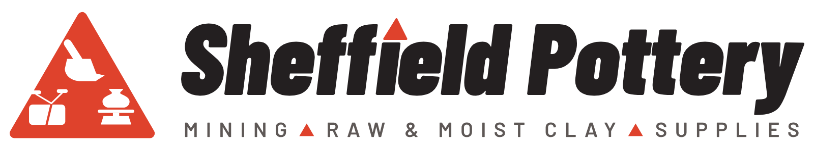

# Sheffield Pottery logo, 2026 refresh

This is a modernized version of the Sheffield Pottery logo. It keeps the parts people
already recognize: the red triangle, the three icons for what we do (mining,
raw & moist clay, supplies), the italic "Sheffield Pottery" wordmark, and
the original red and charcoal. It redraws all of them as clean, bold vector shapes.



## What changed

| | 2023 logo (`original/`) | 2026 refresh |
|---|---|---|
| **Emblem** | Thin dashed/serrated triangle outline with small, detailed icons; muddy below ~60px | Solid triangle with the icons cut out (true transparency). Same three ideas, redrawn so they read at a glance: **excavator bucket** (mining), **block of moist clay mid-cut by a wire tool** (raw & moist clay), **jar on a potter's wheel** (supplies) |
| **Wordmark** | Light-weight italic sans | Heavier, condensed italic (Barlow Condensed Black Italic), outlined to paths. The dot on the *i* is a small brand-red triangle that echoes the emblem |
| **Tagline** | Gray, slashes as separators | Same words; the slashes are now small red triangles. The line is justified to the width of the wordmark |
| **Color** | `#DF422C` red, `#231F20` charcoal | **Kept exactly**, plus a warm cream for dark backgrounds |
| **Extras** | n/a | Round "Since 1946" seal for stickers, boxes and merch; app icon; favicon set |

## Files

### Primary: horizontal lockup
Use this for the website header, invoices, email signatures and anywhere the logo sits on a wide strip.

- `svg/sheffield-pottery-logo-horizontal.svg`: color on light backgrounds
- `svg/sheffield-pottery-logo-horizontal-reverse.svg`: color on dark backgrounds (cream text)
- `svg/sheffield-pottery-logo-horizontal-black.svg` / `-white.svg`: one-color, for stamps, engraving, single-color printing
- `png/sheffield-pottery-logo-header-768.png`: **drop-in replacement for the current Shopify header logo** (`logo.png`, 384×67). This one is 768px wide (2× for retina) with a near-identical aspect ratio, so the theme's existing 360px logo width still fits.

### Stacked lockup
For square-ish spaces: social posts, signage, the top of a printed catalog.
- `svg/sheffield-pottery-logo-stacked.svg`, `svg/sheffield-pottery-logo-stacked-reverse.svg`

### Emblem only
For when the name is already nearby, e.g. a box flap, a pattern, or a watermark.
- `svg/sheffield-pottery-emblem.svg`, `svg/sheffield-pottery-emblem-white.svg`

### Seal
A round badge: "Sheffield Pottery · Sheffield, Mass. · Since 1946", with a serrated edge that nods to the original triangle's border. Good for stickers, clay-box labels, tote bags and social avatars.
- `svg/sheffield-pottery-seal.svg`

### App icon and favicon
At 16–32px three icons turn to mush, so the small mark keeps only the triangle and the jar on the wheel.
- `svg/sheffield-pottery-app-icon.svg`, `png/sheffield-pottery-app-icon-512.png`
- `favicon/`: `favicon.ico` (16/32/48), `favicon-16.png`, `favicon-32.png`, `apple-touch-icon.png` (180), `sheffield-pottery-favicon.svg`

Every SVG has its text converted to outlines, so it needs no fonts installed and looks the same everywhere. Every PNG has a transparent background.

## Colors

| Name | Hex | Use |
|---|---|---|
| Kiln Red | `#DF422C` | Emblem, triangle accents (unchanged from the original) |
| Charcoal | `#231F20` | Wordmark on light backgrounds (unchanged) |
| Slate | `#5E5856` | Tagline on light backgrounds |
| Cream | `#F6EFE6` | Wordmark on dark backgrounds |

## Usage notes

- **Clear space:** keep at least the height of the wordmark's capital "S" clear on every side.
- **Minimum size:** keep the horizontal lockup at 300px wide or more on screen (about 2 in. in print) so the tagline stays legible. Below that, use the emblem or the app icon.
- Don't recolor the emblem's icons, add outlines or shadows, or stretch the logo. To place it on a photo, use the reverse or white version over a dark area.

## Regenerating

Everything is generated from `source/`:

```bash
pip install fonttools uharfbuzz
python3 brand/logo/source/logo.py brand/logo/svg   # rebuild the SVGs
```

`source/export.js` renders the PNGs with Playwright (`node export.js <dir> file.svg:width:out.png …`).

The wordmark uses **Barlow** by Jeremy Tribby (SIL Open Font License 1.1, see `source/fonts/OFL.txt`). The OFL allows its use in logos, including outlined artwork.
